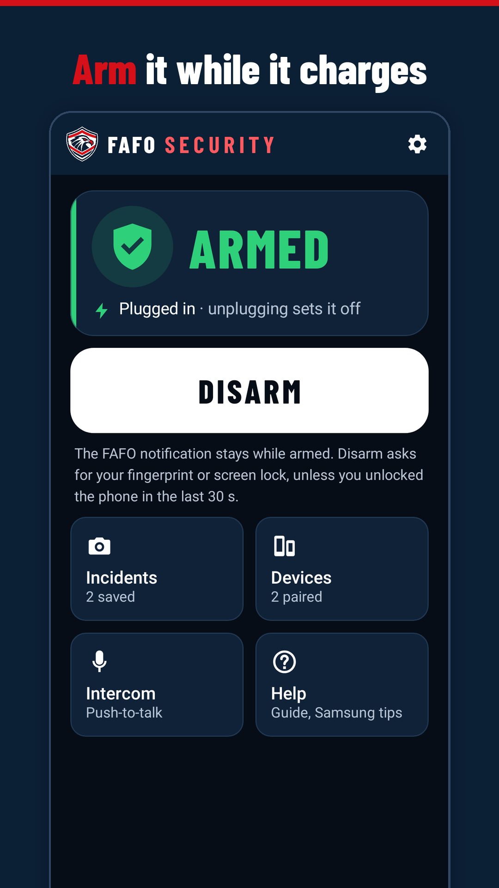
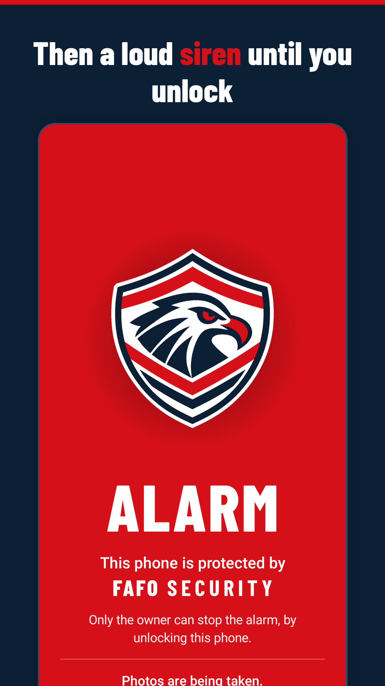
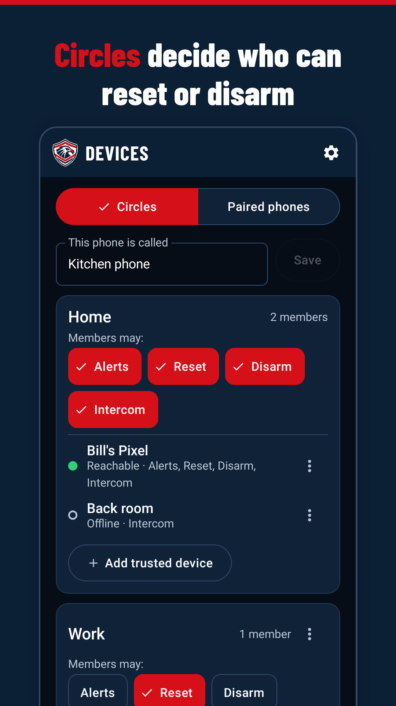
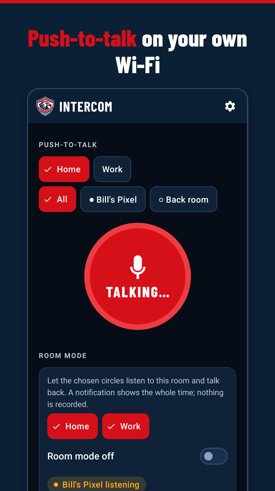

# FAFO Security

**Free Advanced Features Offline.** A free, open-source anti-theft alarm for your own Android phone.

Website and privacy policy: https://crandellws.github.io/fafo-security/

<p>




</p>

## What it does

Arm it while the phone is charging. If someone unplugs it before you unlock, a short warning countdown
plays (plug it back in to cancel), then a siren goes off and keeps going until you unlock, even after a
reboot. Bumps and pick-ups chirp, the front camera takes photos while the alarm is active, and only
devices you paired with your real screen lock count as trusted.

Trusted devices are grouped into circles (Home, Work...) with your own labels ("Register", "Back room")
and per-circle permissions. Nearby trusted devices, on the same Wi-Fi or over Bluetooth, get an alert
when your phone is triggered and can reset the alarm (siren off, stays armed) or disarm it if their circle
allows. Devices in a circle can also use a simple intercom and push-to-talk walkie-talkie on the same Wi-Fi
or Bluetooth.

More screenshots: [store/graphics/phone/](store/graphics/phone/).

## Privacy

- No ads, no analytics, no account, no sign-up, and no server run by the developer.
- All traffic stays between your own paired devices on the local network or Bluetooth, end-to-end encrypted.
- Trigger photos stay on the phone. You can optionally have them emailed to addresses you choose, through
  an email server you set up or (play build) your own Gmail account; nothing is sent unless you set that up.
- The **oss** build contains no Google libraries at all; a Gradle check (`checkNoRemoteDeps`) fails the
  build if one sneaks in.
- Full policy: [privacy-policy.html](https://crandellws.github.io/fafo-security/privacy-policy.html).

FAFO Security protects the device it is installed on. It is not a tool for tracking or monitoring another
person, and it never hides itself: while armed it always shows a persistent notification. The intercom only
works when someone turns it on at the listening phone, shows a notification naming who is listening plus the
system mic indicator, cannot be started remotely and records nothing.

## Platform

Android only (minSdk 30, targetSdk 36), native Kotlin + Jetpack Compose. Two build flavors:

| Flavor | For | Difference |
|---|---|---|
| `oss` | F-Droid and anyone building from source | No Google libraries |
| `play` | Google Play | Adds Google sign-in so trigger photos can be emailed through your Gmail |

Spec: [docs/SPEC-v1.md](docs/SPEC-v1.md). Build plan: [docs/BUILD-PLAN.md](docs/BUILD-PLAN.md).

## Build from source

Requirements: JDK 17 and the Android SDK (platform 36, build-tools; see
[docs/BUILD-PLAN.md](docs/BUILD-PLAN.md) for a scripted install).

```bash
export ANDROID_HOME=/path/to/android-sdk
./gradlew assembleOssDebug assemblePlayDebug   # APKs: app/build/outputs/apk/{oss,play}/debug/
./gradlew test                                 # JVM + Robolectric unit tests
./gradlew lintOssDebug lintPlayDebug
./gradlew checkNoRemoteDeps                    # per-flavor dependency guard
```

Debug builds are signed with the public debug key in [keystore/](keystore/README.md), so a debug APK from
any source installs over the previous one. Never use that key for release builds.

## Install a test build from CI

1. Open the **Actions** tab, pick the latest green **Android CI** run on `main`, and download the
   **fafo-debug-apk-oss** (or **-play**) artifact. Unzip it to get the APK.
2. Copy the APK to the phone and open it from your file manager. Allow **Install unknown apps** for that
   app when asked. If Play Protect warns about an unknown developer, choose **More details > Install
   anyway**: it is a debug build.
3. Open FAFO Security and work through the setup checklist (notifications, camera, full-screen alarm,
   Do Not Disturb access, battery Unrestricted, and on Samsung the sleeping-apps steps).
4. Updating: install the newer APK over the old one. If Android says the package conflicts (for example
   switching between oss and play), uninstall first; this deletes FAFO's photos, trusted devices and keys.

Device test steps: [docs/DEVICE-TESTS.md](docs/DEVICE-TESTS.md).

## Contributing

Issues and pull requests are welcome. Keep the offline promise: no new network endpoints, analytics,
ads or tracking libraries, and nothing Google-specific outside the `play` flavor. Run `./gradlew test` and
`./gradlew checkNoRemoteDeps` before opening a PR. By contributing you agree that your contribution is
licensed under GPL-3.0-or-later. Build-agent notes for AI-assisted work live in [CLAUDE.md](CLAUDE.md).

## License and trademarks

The code is free software: you can redistribute it and/or modify it under the terms of the
**GNU General Public License, version 3 or (at your option) any later version** ([LICENSE](LICENSE)).
Copyright (C) 2026 Bill Crandell. Third-party components: [THIRD-PARTY-NOTICES.md](THIRD-PARTY-NOTICES.md).

"FAFO", "FAFO Security", the FAFO shield and the FAFO wordmark are trademarks of Bill Crandell and are
**not** licensed under the GPL. Forks must use their own name and icon. Details: [TRADEMARKS.md](TRADEMARKS.md).

## Contact

fafo@crandell.ws
